<div align="center">

> 🎮 **Why you'll get hooked:** one more night, one more cave, one more boss. A world that *behaves* (water flows, sand falls, leaves
> decay), creatures that *sound* real, a story with a real ending — all in an **8 MB executable with no launcher and no internet**.
> Download it, punch a tree, and see how far the road to the Sift takes you. 🌅


## 🎯 Press Start

UltimateCraft is a complete **open-world voxel survival game** written from scratch in C. Punch a tree, craft your first
pickaxe, survive the night, raid caves for diamonds, wire up redstone machines, tame wolves, trade with villagers — then follow
**the road to the Sift**: find a lost underground civilisation, open a portal to outer space, defeat a cosmic tyrant and earn the
blessings of the Luminaries in a heaven above the clouds.

<table align="center">
<tr>
<td align="center" width="20%"><h3>🌍 384</h3><b>blocks tall</b><br><sub>68 biomes · 20+ structures</sub></td>
<td align="center" width="20%"><h3>🧱 1,539</h3><b>items</b><br><sub>1,059 blocks · 1,036 recipes</sub></td>
<td align="center" width="20%"><h3>🐺 104</h3><b>mobs</b><br><sub>A* pathfinding · 35 voices</sub></td>
<td align="center" width="20%"><h3>🔊 171</h3><b>real sounds</b><br><sub>recorded, not synthesised</sub></td>
<td align="center" width="20%"><h3>🌌 5</h3><b>realms</b><br><sub>Overworld → Sift</sub></td>
</tr>
</table>

<table>
<tr>
<td>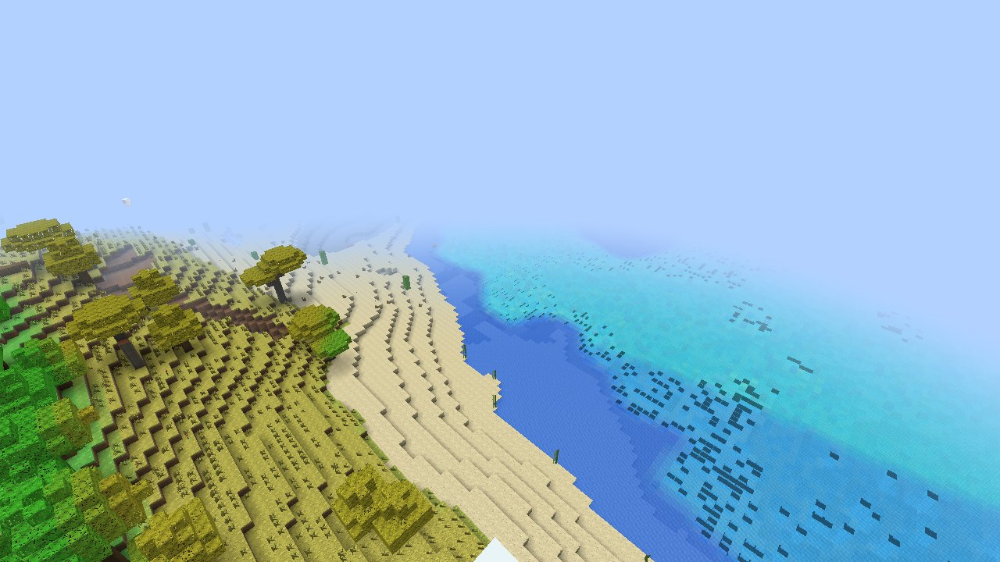</td>
<td>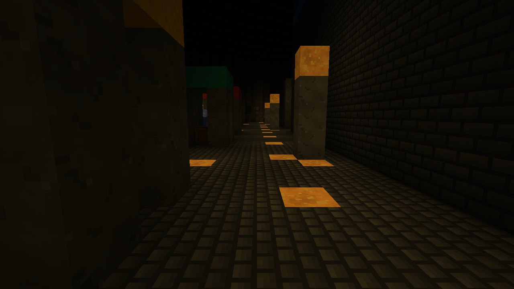</td>
<td>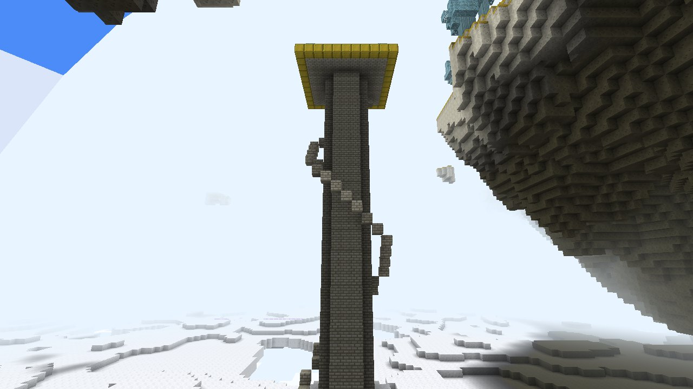</td>
</tr>
<tr>
<td align="center"><sub>🌊 The Overworld</sub></td>
<td align="center"><sub>🏮 The lamplit Underground City</sub></td>
<td align="center"><sub>🌬️ Zephyrine's Spire of Winds, high in the Sift</sub></td>
</tr>
</table>


## 🆕 What's new in v5.1.0 — the *Alive* update

This release is about **feel**: creatures that look and sound like what they are, blocks with real surface detail, and a world
whose physics behave the way your instincts expect.

### 🔊 Real animals, real voices

Every one of the **171 sounds is built from real recordings**: a cow that actually moos, a Siamese cat that actually meows, a horse
whinny, goats, sheep, hens and roosters, a wolf howl, a house sparrow, bats, a bumblebee, a frog, plus real thunder, rain, splashes
and a forge fire. Footsteps and block breaking come from foley recordings of stone, wood, gravel, grass, snow, glass and metal —
with **up to five takes per sound**, so no two footsteps are alike. Monsters (zombies, ghasts, the warden, the dragon…) are
sound-designed from real voice recordings: transposed, layered and drenched in reverb. Distant sounds are muffled by distance, and
subtitles describe them all.

<p align="center">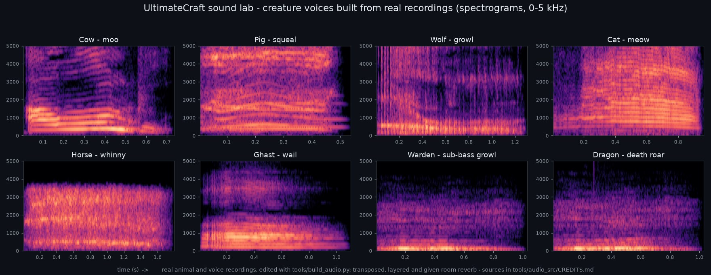<br>
<sub>The sound lab (<code>tools/sound_lab.py</code>): spectrograms of real in-game audio — a real cow's harmonic moo, a real cat's meow</sub></p>

> 🙏 **Every recording is public domain, CC0 or CC BY** and fully credited in [`tools/audio_src/CREDITS.md`](tools/audio_src/CREDITS.md).
> Nothing comes from any commercial game. Rebuild all sounds with `python tools/build_audio.py`.

### 🐮 Mobs that look the part

All 104 creatures are repainted with per-face lighting, edge shading and a real material: **streaked fur, curly wool, feather
scallops, fish scales, rotting cloth**. Animals get lighter bellies, dark hooves and muzzles with nostrils; monsters get brows,
whites-and-pupils, mouths and teeth.

<p align="center">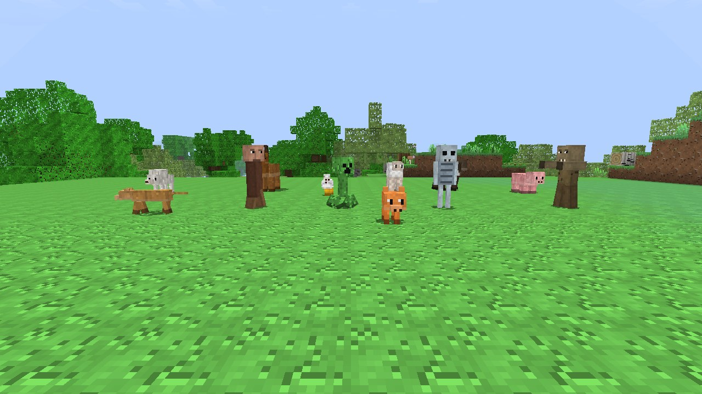<br>
<sub>A husk, a stray, a creeper, a villager, a cat, pigs, cows, sheep, a chicken, a horse, a wolf and a fox — all painted by code</sub></p>

### 🧱 Every block texture, redrawn

Tileable fractal noise gives **stone veins and fissures**, real **cobblestone cells**, pebbled **dirt**, rippled **sand**,
**planks with grain and knots**, ridged **bark**, ringed **log ends**, light-catching **leaves**, banded **deepslate**, glinting
**ores**, **bevelled polished blocks**, brushed **metal**, faceted **gems** and woven **wool**. Water and lava animate in a
seamless 16-frame loop.

<p align="center">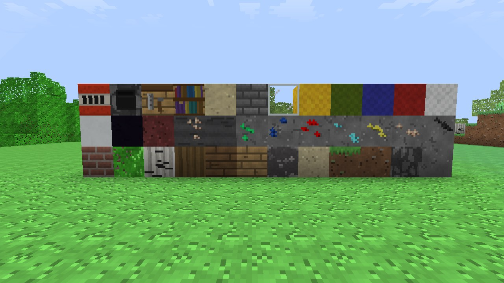<br>
<sub>A wall of blocks, straight from the game: stone → ores → wool, glass, bookshelf, crafting table, furnace, TNT</sub></p>

### 🌊 Physics you can trust

| System                      | How it behaves now                                                                                                                                                                                            |
| --------------------------- | ------------------------------------------------------------------------------------------------------------------------------------------------------------------------------------------------------------- |
| 💧 **Water**          | 8 flow levels + falling water, flows toward the nearest drop within 4 blocks, infinite sources, **currents push you, mobs and dropped items** (waterfalls pull things down)                             |
| 🌋 **Lava**           | Slower than water (faster in Hell), meets water → obsidian / cobblestone / stone, and **randomly ignites nearby flammable blocks**                                                                     |
| ⏳ **Falling blocks** | Sand, gravel, concrete powder and anvils are **real entities**: gravity, drag in water, landing, saved with the world — and **anvils crush** what is underneath                                  |
| 🌳 **Trees & leaves** | Leaves obey the **connected-distance rule**: a log must be reachable through leaves within 6 blocks, so a felled tree's canopy really decays. Leaves **you place are persistent** and never decay |

<table>
<tr>
<td>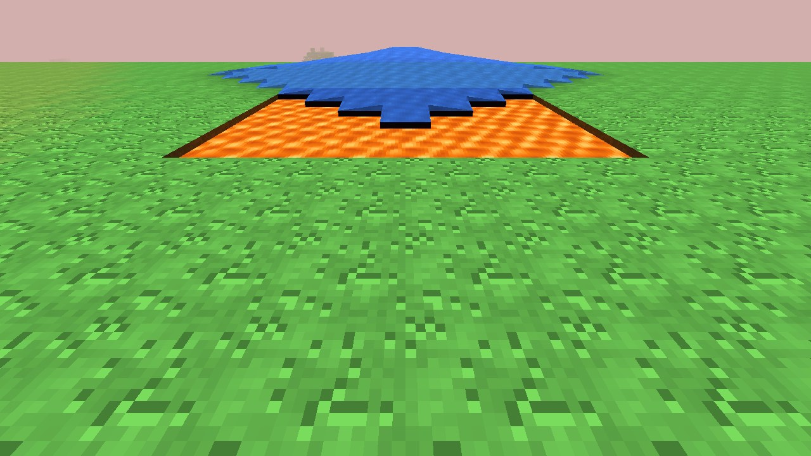</td>
<td>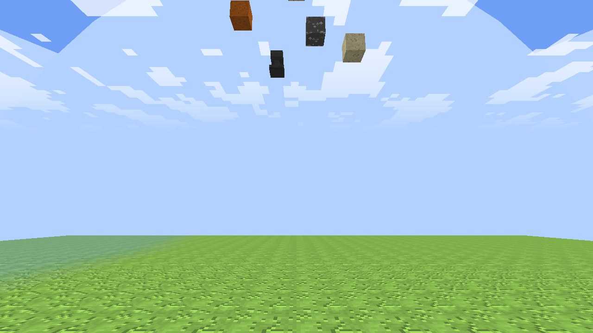</td>
</tr>
<tr>
<td align="center"><sub>🌋 A water stream spreads over flat ground and stops at a glowing lava lake</sub></td>
<td align="center"><sub>⏬ Sand, gravel and an anvil in free fall</sub></td>
</tr>
</table>

### 🧪 Rock-solid tests

Scripted runs use **virtual time, a fixed random seed and fully deterministic chunk loading** (worker threads are awaited and
their chunks applied in a fixed order), so every test is reproducible on any machine, however busy. Two tests that used to flake
about once in 10–25 runs passed **60 out of 60 runs on a deliberately overloaded PC**.

### 🎚️ Mastered sounds

Every take of every sound is level-matched, DC-free and limited so that nothing clips — verified by measuring all 472 files.
(The author could only measure, not listen: if a sound is off to *your* ears, please [open an issue](https://github.com/RajdipDhar2007/UltimateCraft/issues).)


## 🔧 System requirements

<p align="center">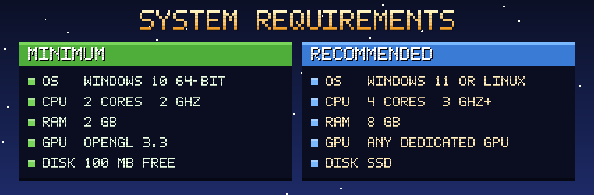</p>

UltimateCraft is light. It is a single ~8 MB executable that talks to **OpenGL 3.3** — no launcher, no installer needed, no internet.

|                    | 🟢 **Minimum**                                                                                                | 🔵 **Recommended**                                              |
| ------------------ | ------------------------------------------------------------------------------------------------------------------- | --------------------------------------------------------------------- |
| **OS**       | Windows 10 / 11 (64-bit) · Linux x86-64 with X11 (or XWayland) · macOS with OpenGL 3.3 (not tested by the author) | same                                                                  |
| **CPU**      | 64-bit dual-core, ~2 GHz                                                                                            | quad-core, 3 GHz or faster (terrain is generated on 4 worker threads) |
| **Memory**   | **2 GB** RAM                                                                                                  | **8 GB** for render distances above 12                          |
| **Graphics** | any GPU with **OpenGL 3.3 Core** support — integrated graphics are fine                                      | any dedicated GPU, for 16+ chunk render distance                      |
| **Disk**     | ~20 MB for the game + space for your worlds                                                                         | an SSD makes loading fastest                                          |
| **Sound**    | optional (WinMM on Windows, ALSA on Linux) — the game runs silently without a sound device                         | stereo speakers or headphones for the 3D audio                        |
| **Input**    | keyboard + mouse (gamepad optional)                                                                                 | —                                                                    |

<details>
<summary><b>📏 How these numbers were measured</b> (click to expand)</summary>

<br>

Measured on the author's laptop — **AMD Ryzen 9 8940HX with the integrated AMD Radeon 610M** (one of the weakest GPUs you can
buy today), Windows 11, a freshly generated world, standing still, V-Sync off. Frame rates are uncapped.

|         Render distance         |   Peak memory   |     Frame rate     |
| :------------------------------: | :--------------: | :----------------: |
|             4 chunks             |      355 MB      |      ~595 fps      |
|   **8 chunks (default)**   | **586 MB** | **~290 fps** |
|            12 chunks            |      943 MB      |      ~131 fps      |
|            16 chunks            |     1.45 GB     |      ~74 fps      |
| 8 chunks, CPU limited to 2 cores |      542 MB      |      ~212 fps      |

About 40 MB of the memory is the decoded sound library. Walking around generates new terrain, so real-world frame rates dip a
little compared with standing still. The *Minimum* column is a conservative estimate derived from these measurements — I could not
test genuinely old hardware, and I have not run the macOS build. If it does not run on yours, please
[open an issue](https://github.com/RajdipDhar2007/UltimateCraft/issues).

Lower the **render distance** in *Options* to trade view range for speed and memory.

</details>


## 🧭 The journey

<table>
<tr>
<td width="50%"></td>
<td>

<p align="center">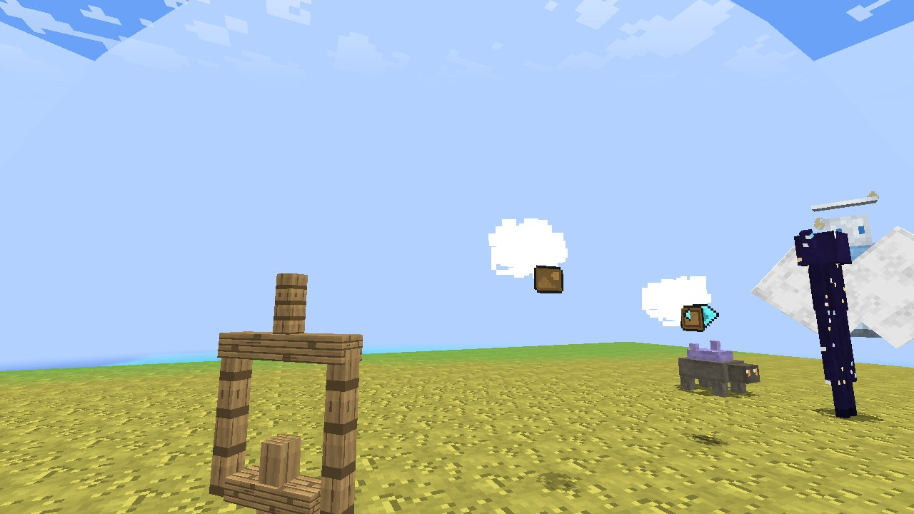<br>
<sub>Some of UltimateCraft's own creatures: Luminaries, the Keeper, souls, sentinels, drifters and crawlers</sub></p>


## ✨ Features

<details open>
<summary><b>🌍 World & survival</b></summary>

- 384-block-tall worlds, **68 biomes**, cave biomes, aquifers, ores and 20+ kinds of generated structures
- **1,539 items**, 1,059 block types (3,509 block states), 1,036 crafting recipes, smelting, stonecutting and smithing
- **104 mobs** with their own AI and **A\*** pathfinding (villagers open doors), breeding, taming and riding
- Day/night cycle, rain, thunder and lightning, fire spread, flowing water and lava, 45 status effects, brewing
- Villagers with jobs, a daily routine (work, meet at the bell, sleep) and reputation-based gossip
- Enchanting, anvils, trading, maps, fishing, item frames, procedural paintings, armour stands
- Four game modes (survival, creative, adventure, spectator) and Easy / Normal / Hard difficulty

</details>

<details>
<summary><b>⚙️ Tech for builders</b></summary>

- **Redstone** with quasi-connectivity, pistons that move slime/honey structures, observers, comparators, hoppers
- Sculk sensors, shriekers and the warden; tripwires; command blocks
- A large command set with selectors and `/execute`, `/scoreboard` with a sidebar, `/data`, `/worldborder`, `/fillbiome`,
  `/loot`, `/function` and **data packs** — with Tab completion

</details>

<details>
<summary><b>♿ Made for everyone</b></summary>

- Fully rebindable controls, **controller support**, toggle sneak/sprint
- Subtitles with direction arrows, colour-blind palette, high-contrast text, reduced motion, a narration hook
- English and German (add more languages with a text file), 30 advancements, statistics, an in-game guide
- Crash-safe saves, automatic world backups, world import/export

</details>

<table>
<tr>
<td>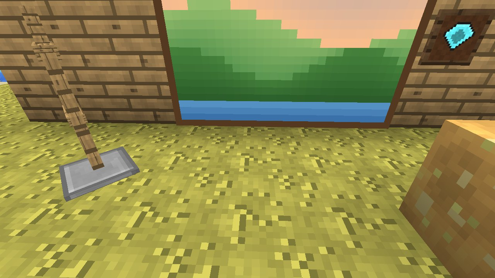</td>
<td>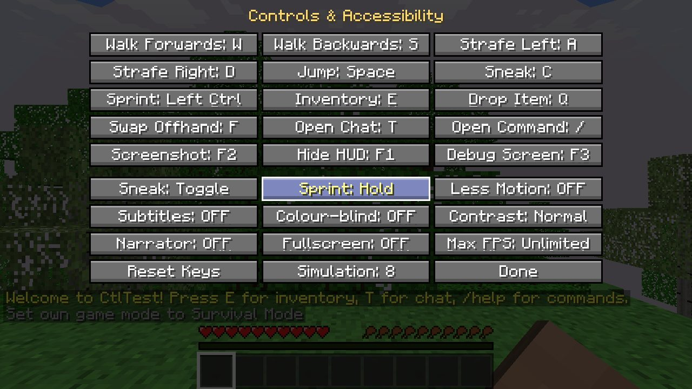</td>
<td>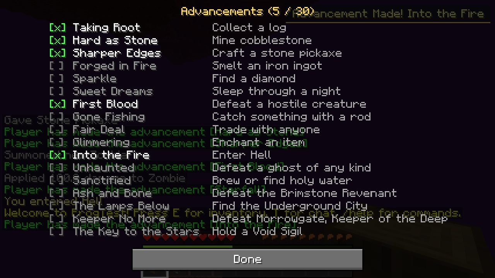</td>
</tr>
<tr>
<td align="center"><sub>🖼️ Procedural paintings, item frames, armour stands</sub></td>
<td align="center"><sub>🎛️ Controls & Accessibility</sub></td>
<td align="center"><sub>🏆 30 original advancements</sub></td>
</tr>
<tr>
<td>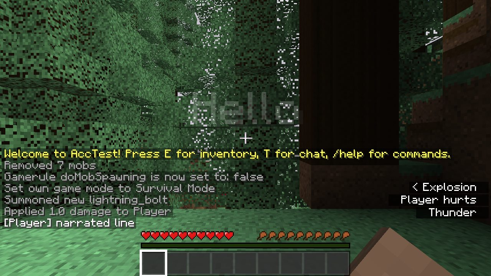</td>
<td>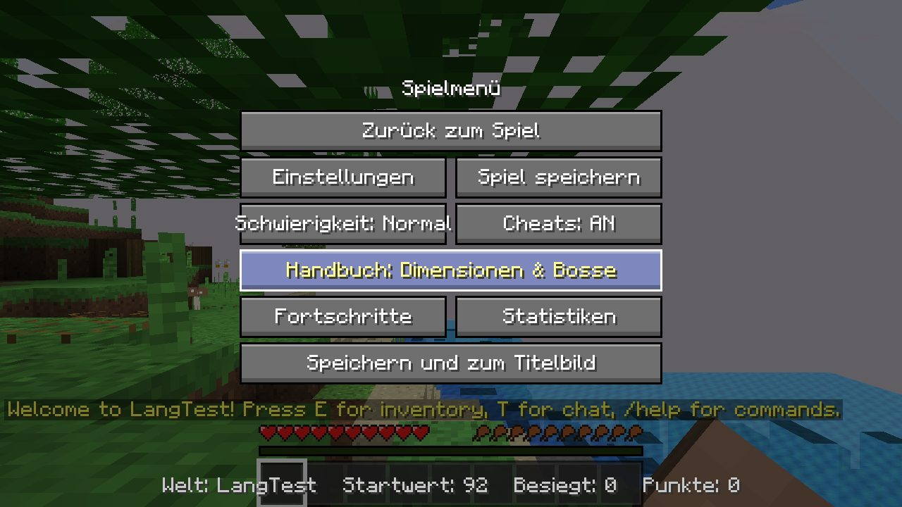</td>
<td>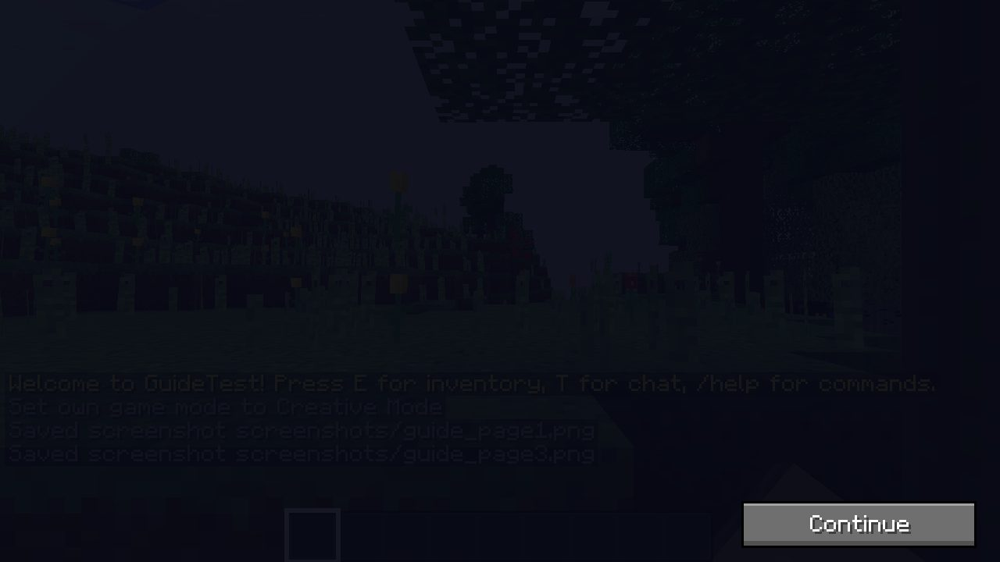</td>
</tr>
<tr>
<td align="center"><sub>💬 Subtitles with direction</sub></td>
<td align="center"><sub>🇩🇪 Localised menus (Deutsch)</sub></td>
<td align="center"><sub>🎬 The Ascension ending</sub></td>
</tr>
</table>


## 🧬 How it is made

| What                                            | Made by                                                                                                                                                      |
| ----------------------------------------------- | ------------------------------------------------------------------------------------------------------------------------------------------------------------ |
| 🧱 **Block atlas, item icons, mob skins** | **drawn by code** — `tools/content/paint.py` & `mobs.py` (Python + Pillow) → `res/textures/`                                                   |
| 🔤 Pixel font, HUD, particles, sky              | **drawn by code** — `tools/gen_assets.py`                                                                                                           |
| 🔊 **All 171 sounds**                     | **real recordings** (public domain · CC0 · CC BY), edited by `tools/build_audio.py` → `res/audio/*.ogg` — [credits](tools/audio_src/CREDITS.md) |
| 🎵 Ambient music                                | generated at start-up from `src/audio/audio.c`                                                                                                             |
| 🌐 Worlds, caves, villages, dungeons            | `src/world/worldgen.c`, `structures.c` — deterministic from the seed                                                                                    |

There are no textures borrowed from any other game, and no sound taken from one. The game is about **23,000 hand-written lines of C**
plus generated content tables. Want to change a creature's colour, add a block or re-mix a creature voice? It is one table row or one
recipe away — see [docs/MODDING.md](docs/MODDING.md). If the `res/audio` folder is missing, the game falls back to a built-in
synthesiser and still runs.


## 📥 Download and play

**Windows:** download `UltimateCraft-windows` (portable folder) or the installer from the [Releases](https://github.com/RajdipDhar2007/UltimateCraft/releases) page — or from
the latest successful run under the **Actions** tab (*Artifacts*). Unzip and run `ultimatecraft.exe`.
**Linux / macOS:** download the matching package and run `./ultimatecraft`. The executable must stay next to its `res/` folder.
Requirement: a graphics card with OpenGL 3.3 (see [System requirements](#-system-requirements)).

Your worlds are stored in `saves/`, backups in `backups/`, screenshots (F2) in `screenshots/`.

### 🚀 First steps (your first night)

1. **Singleplayer → Create New World.** Hints at the top of the screen teach the basics.
2. Punch a tree for wood (hold the left mouse button), open the inventory with **E** and craft planks, sticks and a crafting
   table, then a wooden pickaxe.
3. Before night falls, build a shelter or craft a bed (3 wool + 3 planks) and sleep. Zombies, skeletons, spiders and creepers spawn in the dark!
4. Iron, a furnace, a shield, armour — then go exploring. Open **Game Menu (Esc) → Guide** whenever you want to know where the road leads next.

The full player manual is in [docs/MANUAL.md](docs/MANUAL.md).

## 🎮 Controls

| Action                                        | Keyboard / mouse                                 | Controller            |
| --------------------------------------------- | ------------------------------------------------ | --------------------- |
| Move · Jump                                  | W A S D · Space (double-tap to fly in creative) | Left stick · A       |
| Sneak · Sprint                               | Left Shift · Left Ctrl                          | B · Left-stick click |
| Attack / break · Use / place                 | Left mouse · Right mouse                        | RT · LT              |
| Hotbar                                        | 1–9 / mouse wheel                               | LB / RB               |
| Inventory · Drop · Swap offhand             | E · Q · F                                      | Y · X · –          |
| Chat · Command                               | T · / (Tab completes)                           | –                    |
| Hide HUD · Screenshot · Debug · Fullscreen | F1 · F2 · F3 · F11                            | –                    |
| Game Menu                                     | Esc                                              | Start                 |

Every key can be changed in **Options → Controls & Accessibility**.

## 🛠 Building from source

You need a C11 compiler and `make`. Everything else (GLFW, glad, cglm, stb_image, stb_vorbis, noise1234) is bundled in `lib/`.

**Linux**

```sh
sudo apt install build-essential libx11-dev libxrandr-dev libxinerama-dev libxcursor-dev libxi-dev
make -j4 && ./ultimatecraft
```

**macOS** (Xcode command-line tools)

```sh
make -j4 && ./ultimatecraft
```

**Windows** — install [MSYS2](https://www.msys2.org), open the *MSYS2 UCRT64* terminal in this folder:

```sh
pacman -S --needed mingw-w64-ucrt-x86_64-gcc make
sh build_windows.sh        # -> ultimatecraft.exe (static, no DLLs; `make CONSOLE=1` keeps a console window)
```

**GitHub Actions** builds all three platforms on every push (`.github/workflows/build.yml`), runs the headless test
scripts on Linux, packages a portable Windows folder plus an installer, and publishes a Release for tags like `v5.1.0`.
`sh tools/package.sh windows|linux|macos` creates the same packages locally.

**Regenerating the assets** (only if you edit `tools/`):

- `python tools/gen_assets.py` (Python 3 + Pillow) rewrites `res/textures/` and the generated C tables in `src/gen/`.
- `python tools/build_audio.py` (numpy, scipy, ffmpeg) rebuilds `res/audio/` from the recordings in `tools/audio_src/`.
- `python tools/make_banner.py` redraws the README artwork.

### 🧪 Tests

The game drives itself from scripts: `./ultimatecraft --script tests/<name>.txt --no-audio` (headless with `xvfb-run` on Linux).
Scripted runs use virtual time and a fixed random seed, so results are identical on every machine. `tests/run_all.sh` runs all
**45 scripts (537 checks)** — bosses, dimensions, redstone, commands, saves, accessibility, and the `falling`, `trees` and
`fluids` physics scripts.
Export every sound with `./ultimatecraft --export-sounds out/` and render the sound lab with
`python tools/sound_lab.py out docs/images/sound_lab.jpg`.

## 📚 Documentation

| Document                                                       | Contents                                                               |
| -------------------------------------------------------------- | ---------------------------------------------------------------------- |
| [docs/MANUAL.md](docs/MANUAL.md)                                | Player manual: the journey, survival tips, game modes, troubleshooting |
| [docs/COMMANDS.md](docs/COMMANDS.md)                            | Every command with its syntax                                          |
| [docs/MODDING.md](docs/MODDING.md)                              | Data packs, languages, adding blocks/items/mobs/sounds, save formats   |
| [docs/DEVELOPMENT.md](docs/DEVELOPMENT.md)                      | Architecture, feature inventory, the test-script language              |
| [docs/RELEASE.md](docs/RELEASE.md)                              | Releasing on GitHub, itch.io and Steam                                 |
| [docs/ROADMAP.md](docs/ROADMAP.md)                              | What comes next: multiplayer, performance work                         |
| [CHANGELOG.md](CHANGELOG.md)                                    | Version history                                                        |
| [tools/audio_src/CREDITS.md](tools/audio_src/CREDITS.md)        | **Sound credits** — every recording and its author              |
| [CONTRIBUTING.md](CONTRIBUTING.md) · [SECURITY.md](SECURITY.md) | How to help · how to report problems                                  |


## 🖼 Gallery

<table>
<tr>
<td>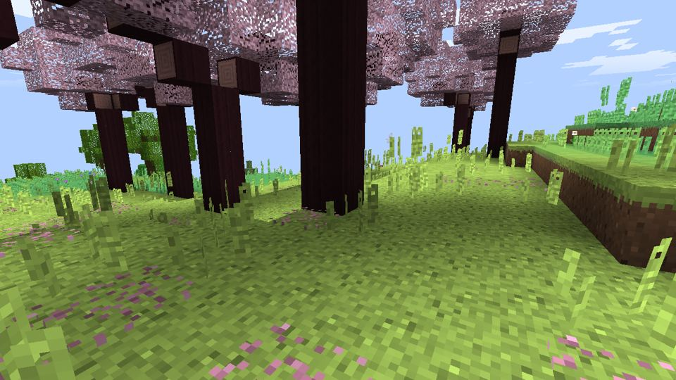</td>
<td>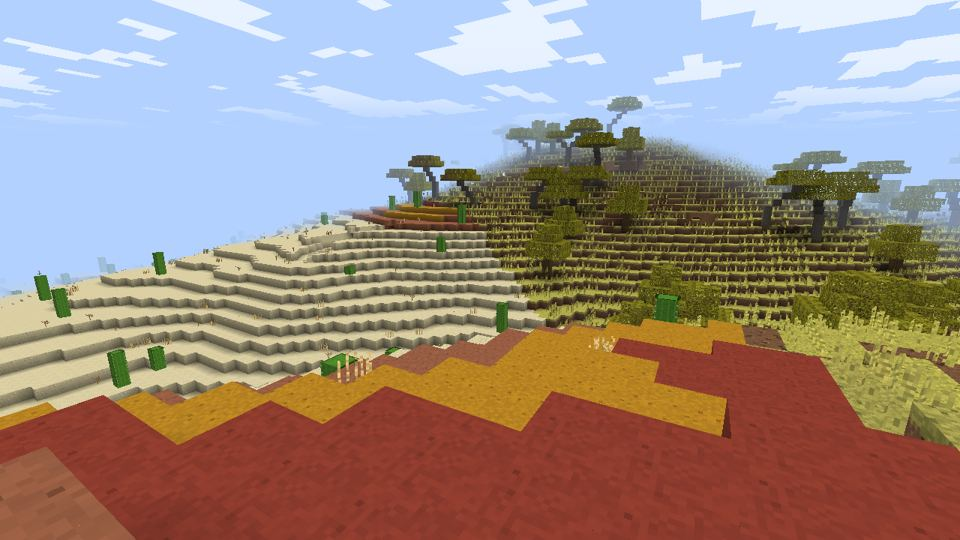</td>
<td>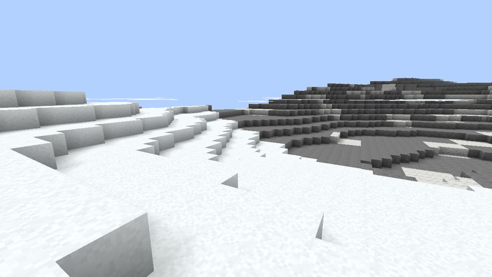</td>
</tr>
<tr>
<td>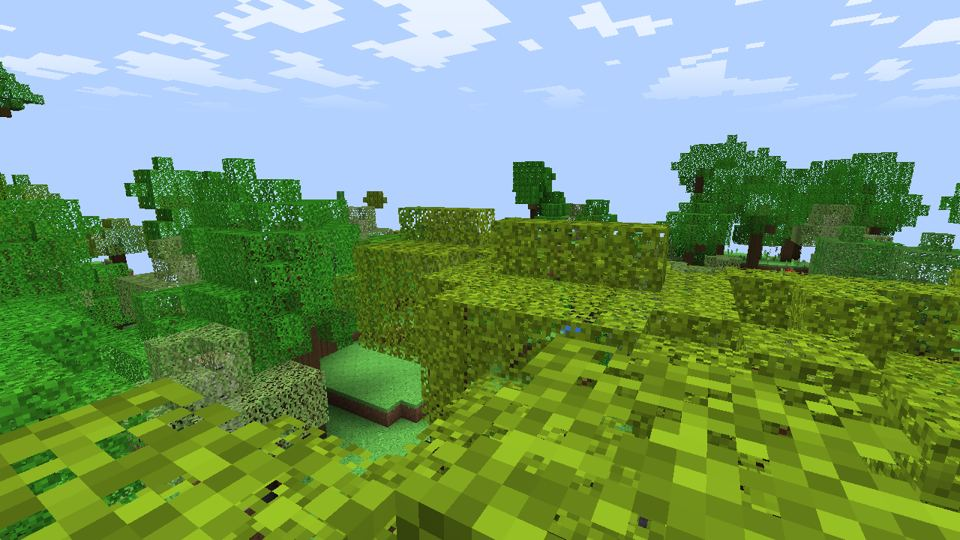</td>
<td>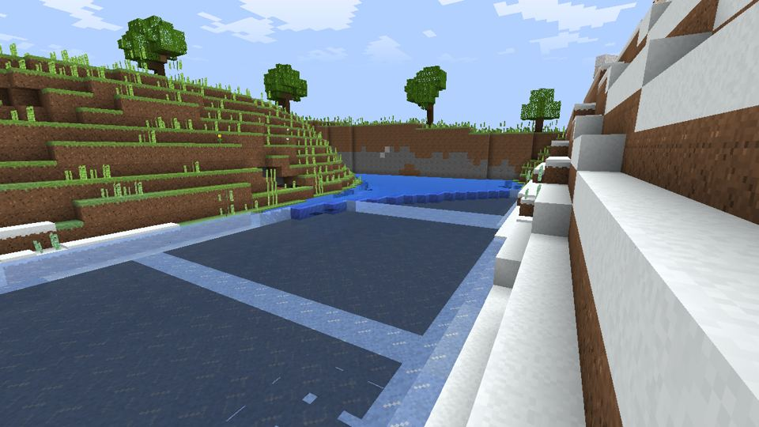</td>
<td>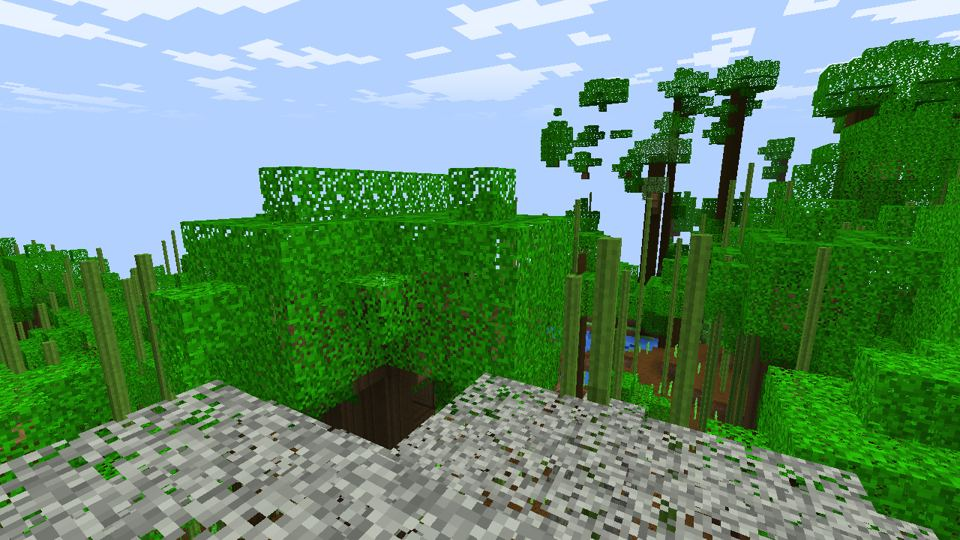</td>
</tr>
<tr>
<td>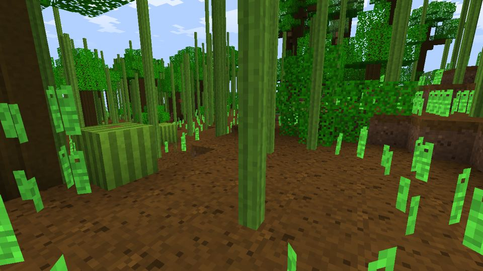</td>
<td>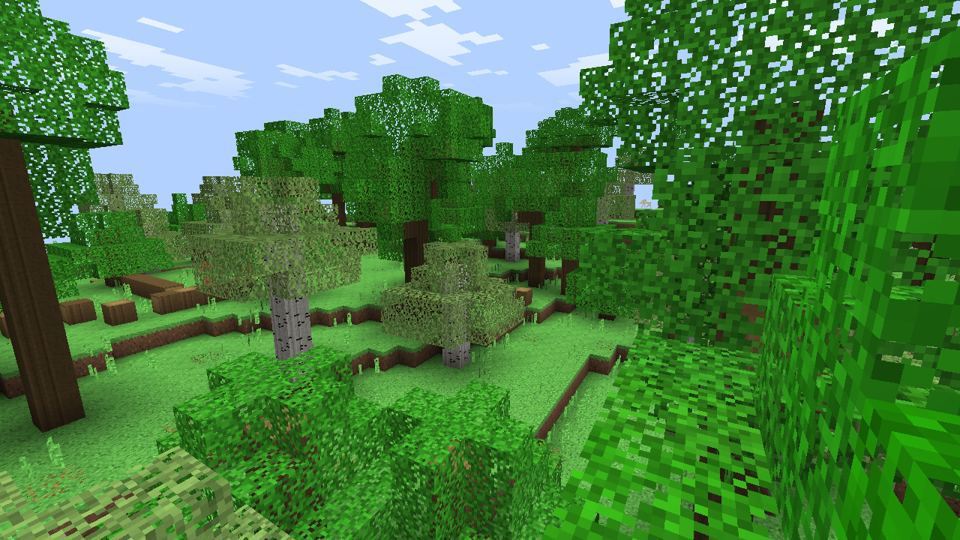</td>
<td>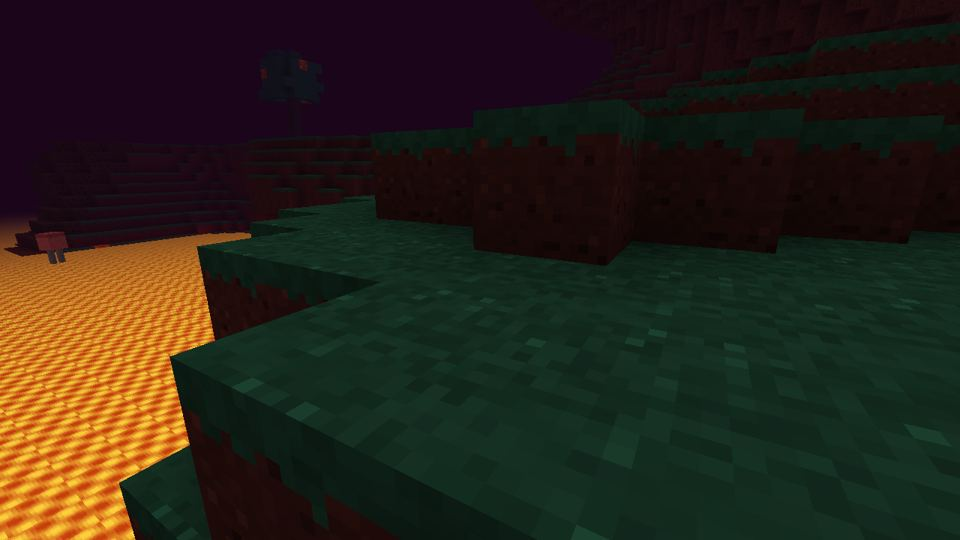</td>
</tr>
<tr>
<td>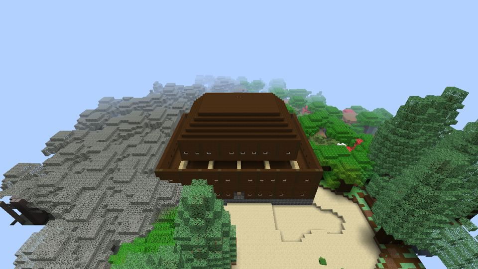</td>
<td>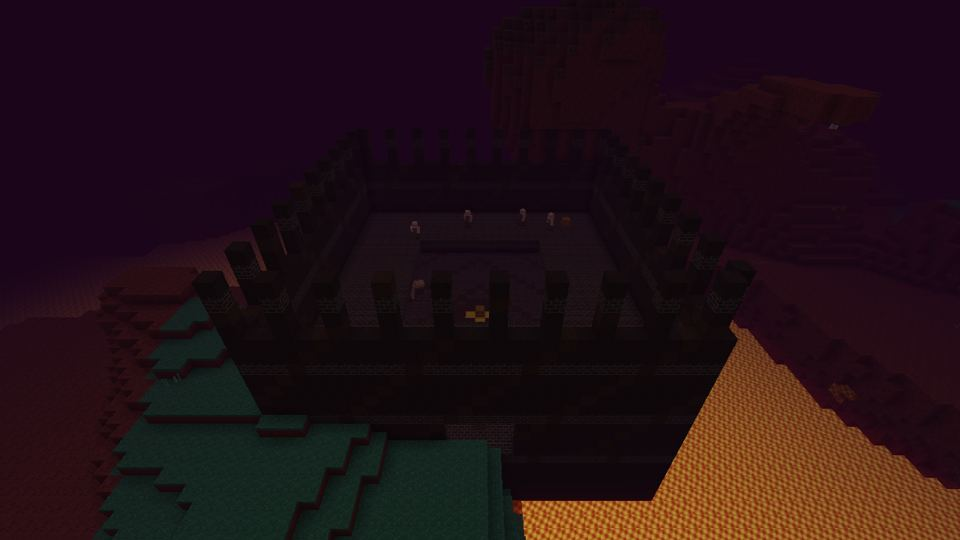</td>
<td>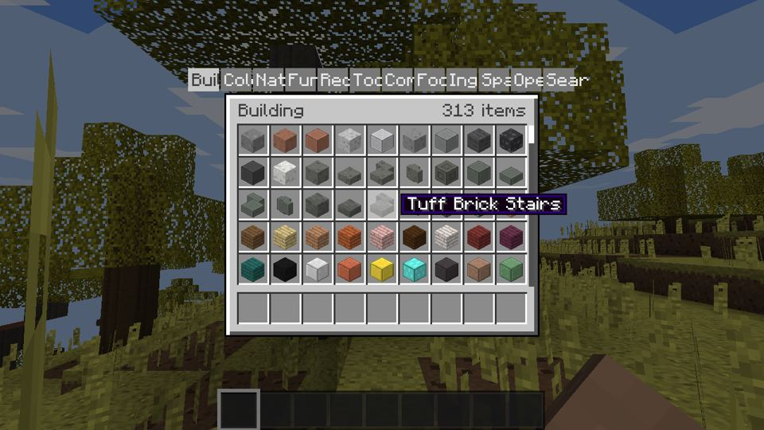</td>
</tr>
</table>

## 🤝 Contributing

Bug reports, translations, new creature voices and pull requests are welcome — see [CONTRIBUTING.md](CONTRIBUTING.md). Please run
the test scripts that touch your change, and add a script under `tests/` for new features. New languages only need a copy of
`res/lang/en_us.lang`. By contributing you agree to the contribution terms in [LICENSE](LICENSE) (section 4).

## 📜 Licence

UltimateCraft is **source-available**, not open source: you may read, build, play and mod it, share your own add-ons, and stream
or record it — but you may not redistribute or sell the game or publish it on a store. See [LICENSE](LICENSE) for the exact
terms, [EULA.md](EULA.md) for players, [PRIVACY.md](PRIVACY.md) (no data is collected) and
[THIRD_PARTY_LICENSES.md](THIRD_PARTY_LICENSES.md) for the bundled libraries. The sound recordings keep their original open
licences — see [tools/audio_src/CREDITS.md](tools/audio_src/CREDITS.md).

<div align="center">
